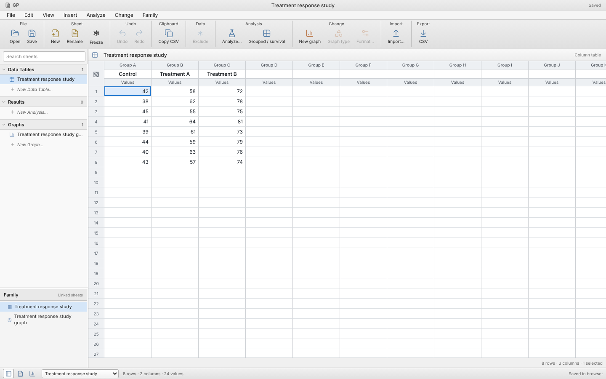

# GP

A scientific workbook with linked data, analysis, and graph sheets, being reconstructed from Prism installer evidence. GP is an independent implementation and is not yet a complete replacement for GraphPad Prism.

The interface now uses a compact macOS-style workbook, light navigator, dense spreadsheet, grouped toolbar, and desktop dialogs. See [current screenshots and the visual correction](docs/ui-macos-correction.md) for the implemented appearance and remaining differences.

**View → Use system appearance / Light appearance / Dark appearance** controls the workbook theme. The [supplied Prism 10 macOS guide](docs/prism10-guide-findings.md) provides newer screenshots and a concrete list of remaining workflow differences.

The [completion plan](docs/completion-plan.md) and [execution log](docs/completion-progress.md) track the full guide, Prism 11 differences, outstanding features and verification requirements. Planned work is not completed work.

The [1,574-row parity audit plan](docs/prism-parity-plan.csv) retains every submitted finding and fills each plan and notes field. Its option-level requirements supplement the earlier guide and equation inventory.



## Browser app

For a website like SimpleCalcium, use the self-contained browser build. Calculations and exports run on the visitor’s device; no Python server is needed. See [browser hosting and testing](docs/browser-hosting.md) for the Cloudflare Pages build settings and a short test workflow.

To run on your own computer, install Node.js 24.18.0 and Python 3 (with `venv` support), then run:

```bash
git clone https://github.com/samgillman/GP.git
cd GP
bash scripts/build_site.sh
python3 -m http.server 8001 --bind 127.0.0.1 --directory web/dist-static
```

Open **http://localhost:8001** in a browser on that same computer. Keep the terminal running; Ctrl+C stops the server. The first build downloads dependencies, and the first calculation loads the scientific runtime. No Prism installation or REA setup is needed to run GP.

For a public website, connect this repository's `main` branch to Cloudflare Pages, use **Build command** `bash scripts/build_site.sh`, **Build output directory** `web/dist-static`, and **NODE_VERSION** `24.18.0`. See [the hosting guide](docs/browser-hosting.md) for the full steps. The requested public domain is **gp.samgillman.org**. Its deployed version has not been independently verified from this environment; a GitHub push alone does not establish that the site is updated.

## Server development mode

Prerequisites: Python 3.12 and Node.js 24.18 (see `.nvmrc`).

```bash
bash scripts/setup.sh
bash scripts/start.sh
```

The server listens on port 8000 and serves the built interface and API together. Set `GP_HOST` and `GP_PORT` to change the bind address and port. In the cloud environment, use its supported application access mechanism; onboarding does not provide a localhost web preview. Live server processes must be restarted after restoring an environment snapshot.

For frontend development, run the backend and `npm --prefix web run dev` in separate shells. Vite proxies API requests to port 8000.

## Workflow

1. Use **New Data Table and Graph**, an example, a pasted spreadsheet block, or **Import data** to add a table. The navigator separates Data Tables, Results, and Graphs; Family lists related sheets.
2. Open **Analyze Data…**, choose the analysis and datasets, and create a separate result sheet. Multiple analyses remain in the workbook. Editing source observations automatically recalculates eligible linked results. Incomplete cells pause the affected analysis; failures stay visible, and **Recalculate analysis** retries. Background updates preserve sheet selection and undo/redo. Missing cells are omitted; paired and XY analyses use complete row pairs.
3. From a result sheet, use **New graph of existing data** to create a linked graph with its fitted curves. **Format Graph…** controls appearance, dataset selection/order, and the linked result. Apply keeps the dialog open; Cancel discards changes made since the last Apply. Double-click the title or an axis title to edit it on the graph; click graph text to select it and format it from the **Text** toolbar (font, size, bold, italic, color).
4. Export a graph with **File › Export…** as PDF, TIFF, PNG, JPEG, or SVG, choosing resolution, width, and a white or clear background. **Save workbook** preserves all tables, results, graph settings, and links in GP JSON. **Open workbook** also accepts earlier single-project GP files. Export individual tables as CSV.

Use **Undo**/**Redo** for workbook edits, sheet creation and graph-format changes. Keyboard shortcuts are Ctrl/Cmd+Z, Ctrl/Cmd+Shift+Z, and Ctrl+Y; typing fields retain their own undo behavior. History is kept only for the current session, up to 40 changes and 32 MiB of snapshots. Opening another workbook or reloading clears history. Undoing a data edit restores its associated result state and cancels pending analysis responses.

Only Column and XY tables participate in this workbook model currently. Grouped and survival analyses have a separate workspace and input document. Recalculation timing and dialog transaction rules are independently implemented; their full equivalence to Prism remains unverified.

GP also imports supported raw data tables from Prism XML (`.pzfx` or `.xml`) and observed ZIP-based Prism project/template containers (`.prism`, `.prismt`, or `.pzt`, identified by content). Choose the desired table when a file contains several. This importer handles raw Column/OneWay and XY tables with one subcolumn per series. It preserves missing-cell positions and reports unsupported layouts. Excluded XML observations become missing cells with a warning; their original values and exclusion state are not retained. Unsupported ZIP cell flags reject the table. The importer does not import Prism graphs, analyses, formatting, or legacy `PCFFGRA4` binary projects. Replicate subcolumns, preaveraged data, and other table families require future work.

Use **Freeze sheet** on a data table to protect its values and structure, or on current results and graphs to keep their captured inputs/output while the source changes. **Unfreeze sheet** resumes eligible updates. Frozen graph details are read-only. Freezing and unfreezing are undoable; snapshots are retained in the workbook file. The current source-table deletion policy still removes its linked family.

Workbook version3 gives datasets and represented rows stable identities. Earlier GP v1/v2 documents migrate on open; unsupported/malformed identity metadata is rejected without replacing the current workbook. Native Prism file formats remain separate from this GP schema.

## Analyses

- Descriptive statistics, sample SD/SEM, Student-t confidence intervals, geometric summaries, type-6 quartiles/percentiles, coefficient of variation, unbiased skewness/excess kurtosis, and mean ± SD reference lines.
- Two-sided Welch and paired t-tests with confidence intervals for the difference.
- Ordinary one-way ANOVA and eta squared (no post-hoc comparisons).
- Independent unweighted linear regressions with fitted lines and slope intervals.
- Ten recovered equation choices: one-/two-phase exponential decay, exponential association, Michaelis–Menten, Gaussian, straight line, log-dose stimulation/inhibition, and normalized inhibition with concentration or log-concentration input. X values for log-dose models must already be log10-transformed. Normalized models fix the response plateaus at 0 and 100.
- **Grouped & survival** workspace: right-censored Kaplan–Meier curves with log-log Greenwood intervals and global logrank; balanced ordinary two-way ANOVA with interaction. Paste/import long-format CSV and explicitly map factor, response, time, and event columns. Unsupported designs are rejected.
- Four-parameter logistic dose-response fits for nonnegative concentrations, including zero-dose controls in fitting. Zero cannot be displayed on a logarithmic axis. Parameter confidence intervals and global/shared-parameter fitting are not implemented.

Assumptions and fit limitations appear with the results. These routines use standard scientific Python libraries. Source-hashed saved Prism examples now verify paired-test results, two four-parameter and three normalized dose-response fits, a balanced two-way ANOVA, and 714 populated survival-table values. This is bounded reference-case validation, not complete functional or numerical parity with the commercial runtime. See [the investigation record](docs/prism-investigation.md) for observed evidence and implementation boundaries.

## Reconstruction status

The goal is complete functional equivalence, including Prism's UI and UX, and it is **not complete**. [The coverage ledger](docs/prism-coverage.json) distinguishes recovered evidence, implemented behavior, and verified cases for observed analysis families and all 152 recovered equation records. [Resource findings](docs/prism-resources.md), [native format findings](docs/prism-native-map.md), [graph-format findings](docs/prism-graph-format.md), and [UI structure findings](docs/prism-ui-map.md) retain exact scope and source identities. The supplied installer provides static and saved-result evidence; a running Prism reference is not currently available. GP's appearance and interactions are not verified as equivalent to Prism.

## Verification

```bash
.venv/bin/python -m pytest tests
npm --prefix web test
npm --prefix web run build
```

`requirements.lock` captures the tested Python environment. `web/package-lock.json` locks frontend dependencies. Refreshing dependencies should be deliberate and followed by the tests.

## Repository and evidence

Application source is in `gp/` and `web/`. REA is maintained separately at `/workspace/rea` in the prepared cloud environment. The supplied installer, extracted application, and full investigation output live outside this repository in `/workspace/gp-inputs` and `/workspace/gp-evidence`. GP does not bundle Prism binaries or graphical assets.

Prism reconstruction uses the [REA skill and tools](https://github.com/morluto/rea) through the repository launcher and MCP interface. [AGENTS.md](AGENTS.md) requires source hashes, REA Evidence IDs and explicit separation of static findings, runtime observations and GP implementation choices. The latest [compiled UI evidence](docs/prism-ui-rea-evidence.md) covers selected original menus, point inspectors and formatting dialogs; [native-code observations](docs/prism-native-code.md) record bounded decompilation findings. New [freeze](docs/prism-freeze-rea-evidence.md) and [zoom](docs/prism-zoom-rea-evidence.md) reports retain completed REA records and their unresolved scope. Ordinary development tests verify GP behavior; they do not establish Prism equivalence.
