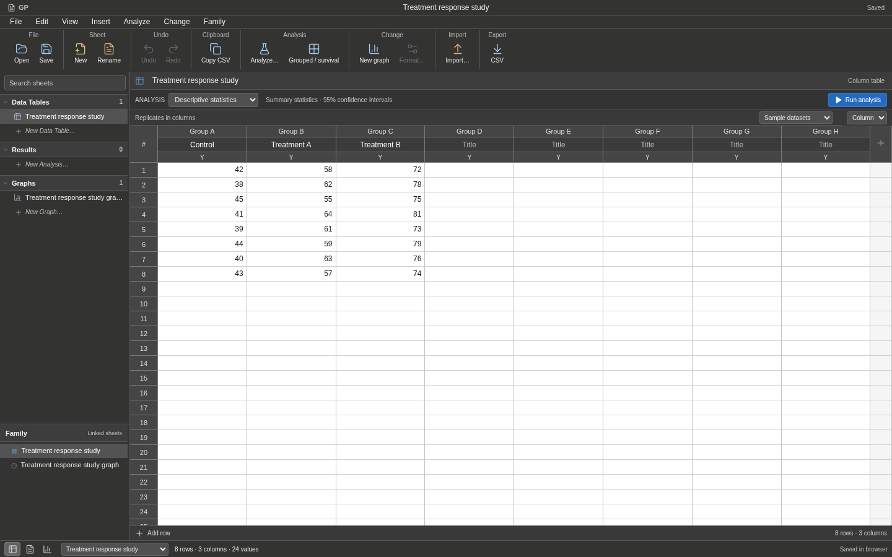
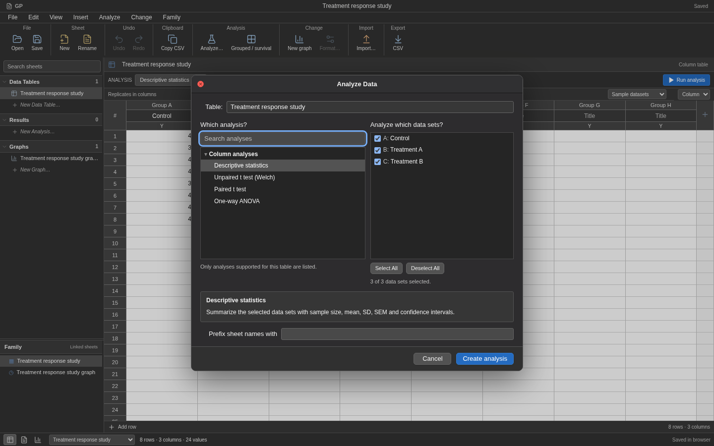

# User-supplied Prism 10 macOS guide

`PRISM10_GUIDE.html` supplies a substantially better visual and workflow reference than the older official illustrations used for the first appearance correction. It contains 51 embedded image occurrences (46 unique image hashes), covering the workbook, all eight table families, analysis parameters, results, graph creation, Format Graph, Format Axes, layouts, and export.

The author identifies the application as **Prism 10.3.1, build 464, on macOS**, and dates the exploration 19 October 2026. The guide distinguishes live observations, GraphPad documentation, resource-only options, and earlier lab work. These distinctions are preserved: a claim in the guide is not an independently repeated runtime test, and Prism 10 observations do not establish Prism 11 behavior. The target remains Prism 11.1.0 for macOS.

[The source index](prism10-guide-index.json) records the uploaded HTML's SHA-256, section anchors, image captions, and image hashes. The original guide and extracted reference images are retained in the working environment, outside application assets. Code and scripting recipes in the document were read as reference material, not executed.

## First implemented correction

The supplied images show dark macOS chrome with white worksheet cells. GP now supports **View → Use system appearance / Light appearance / Dark appearance**. System appearance tracks the operating-system setting; an explicit choice persists in browser storage separately from the workbook. The navigator, toolbar, menus, table headers, and workbook dialogs use dark surfaces while numeric cells and scientific graph pages remain white. Graph colors, numerical inputs, saved analyses, and exported figures are not modified by an appearance change. The separate grouped/survival workspace still uses its existing light appearance.

This is an implemented theme informed by screenshots, not a pixel-identical reproduction of the full native interface.

## Concrete remaining obligations

| Guide reference | Evidence or reported behavior | GP gap / next implementation work |
| --- | --- | --- |
| §1.3–1.4, images 4–10 | Compact two-row toolbar; five navigator sections; sheet-specific commands; status-bar navigation | GP still has three sheet families, a simplified toolbar and status bar. Add actual Info and Layout models before enabling their controls. |
| §2.1–2.5, images 11–21 | Row titles, replicate subcolumns, table-specific entry formats | Current workbook supports raw single-subcolumn Column/XY only. Requires data-model, import/export and analysis-input changes together. |
| §3.3–3.4, images 24–29 | Analysis selection followed by a separate parameter dialog; design/options/model/constraints tabs | GP's analysis chooser runs a limited set of fixed options. Full parameter dialogs and backend settings remain necessary. |
| §3.6, images 30–32 | Results with multiple tabs and warning notes | GP presents one summary view. Result schemas need distinct, persistent subtables. |
| §3.7 | Author reports automatic recalculation after data/parameter changes | GP currently marks results stale and requires explicit recalculation. Add dependency-aware background execution, cancellation, error state, and undo-aware tests; do not merely hide stale warnings. |
| §4.1–4.3, images 34–41 | Create Graph chooser; per-dataset appearance; data ordering; graph settings; annotations tab for Column/Grouped | GP's graph choices and formatting remain limited. Existing three-tab dialog is not the complete native dialog. |
| §4.4, images 42–48 | Separate Format Axes dialog, origin/range/ticks/fonts, including manual ranges and axis-specific settings | No complete Format Axes implementation. Preview and export must use the same validated settings. |
| §5.1–5.2, images 49–51 | Linked multi-graph layouts and export controls | GP has individual graph exports but no layout document model or layout export. |
| §6–7 | Script commands, ZIP references, binary graph/layout observations | Useful format hypotheses to cross-check against the supplied Prism 11 installer/projects. Not evidence that the recipes work in GP or Prism 11. |

## Verification

Both frontend builds and the existing 25 frontend tests pass. The browser desktop check now also verifies OS appearance changes, explicit overrides across reloads, unchanged workbook content after theme changes, and white data cells under dark chrome. It retains the previous editable-grid, dialog-focus, graph/results visibility, and mobile-dialog checks. Screenshot review verifies the implemented dark data sheet and analysis chooser. These are GP checks, not comparisons against a running Prism installation.
