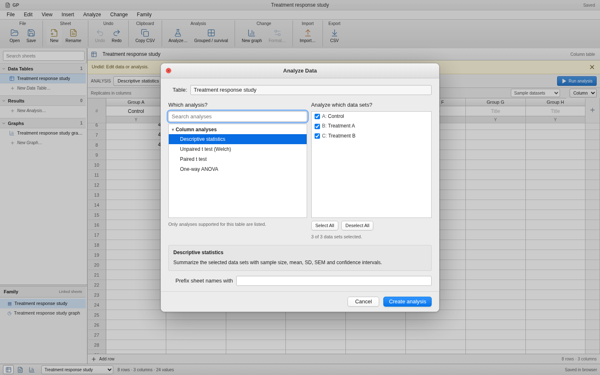
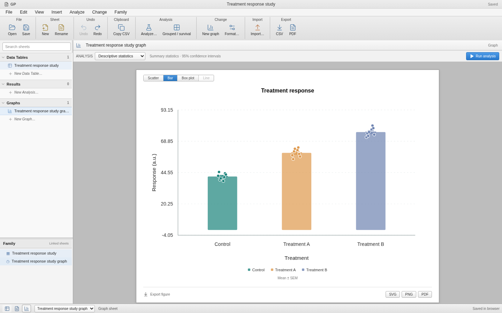
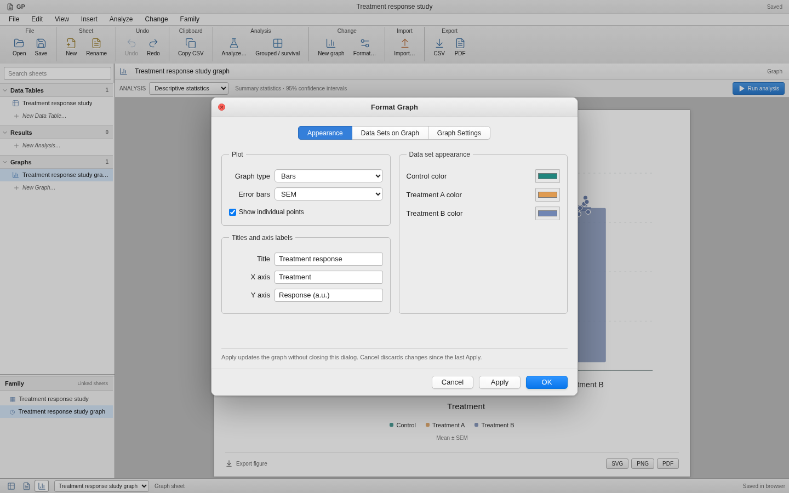
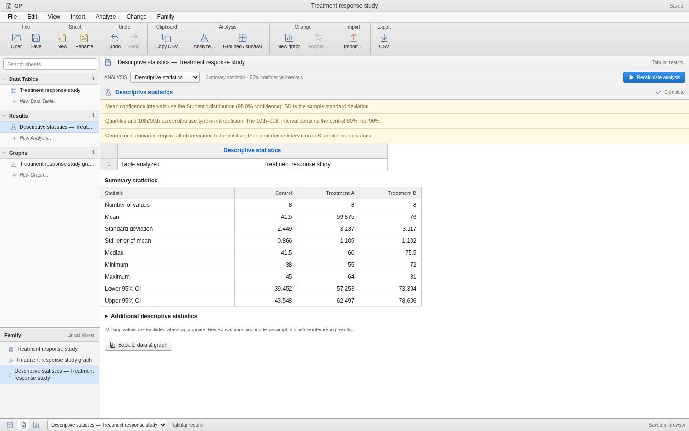

# macOS workbook appearance correction

The initial GP interface used a dark sidebar, large page headings, cards, and widely spaced inputs. Those choices did not resemble Prism for macOS. This correction rebuilds the application shell around a compact desktop workbook.

- Light disclosure navigator for Data Tables, Results, and Graphs, with a separate Family pane.
- Small document title, working application menus, and grouped toolbar commands.
- Full-sheet grid with group/title/type headers, row numbers, blue focus selection, and editable empty rows and columns.
- White graph page on a gray workspace, and tabular results with statistics arranged down rows.
- New Table dialog with table-family navigation and a preview; Analyze dialog with analysis and dataset lists; Format Graph dialog with three tabs and standard Apply/OK/Cancel controls.
- Modal focus containment, Escape cancellation, and focus restoration. The separate grouped/survival workspace also uses compact neutral controls.

## Current GP screenshots

These are screenshots of the implemented browser app, captured by `scripts/check_desktop_ui.py` at 1440 × 900. They are not screenshots of Prism.










[New-table dialog](images/new-table.png) · [Mobile dialog](images/mobile-dialog.png)

## Reference evidence and limits

The [reference manifest](ui-visual-references.json) records official GraphPad image URLs, source hashes, observed platform, and the purpose of each reference. The macOS window image in the current guide illustrates an older Sierra-era window; its presence in the Prism 11 guide does not establish that it depicts Prism 11.1. The current product illustrations supplement the recovered installer controls documented in [the UI structure map](prism-ui-map.md).

This is a substantial visual correction, not verified pixel or interaction equivalence with Prism 11.1.0. Icons are independently supplied by Lucide. Exact native spacing, fonts, menus, full inspector behavior, spreadsheet selection/navigation, graph rendering defaults, and unsupported table/analysis families remain incomplete. No running Prism reference was available. Proprietary screenshots and application assets are not embedded in GP.

## Validation

Both server and static frontend builds pass, as do the 25 frontend tests. Chromium checks cover the existing workbook import/analyze/recalculate/save/open workflow, graph formatting transactions, undo/redo, recovery, scientific reference cases, and SVG/PNG/PDF export. The desktop-specific check verifies editing an empty cell expands the actual dataset, undo restores it, menu dismissal works, modal focus is contained and restored, graphs are visible without the data sheet covering them, results render, and mobile dialogs fit the viewport.

To repeat the desktop check against a running static build, install Playwright in your test environment, install its Chromium browser, and run:

```bash
python scripts/check_desktop_ui.py http://127.0.0.1:8001
```

For an existing Chromium installation, set `GP_CHROMIUM` to its executable path. Set `GP_SCREENSHOTS` to change the output directory (default `/tmp/gp-desktop-ui`). These checks demonstrate GP behavior; they do not compare against an executing Prism application.
